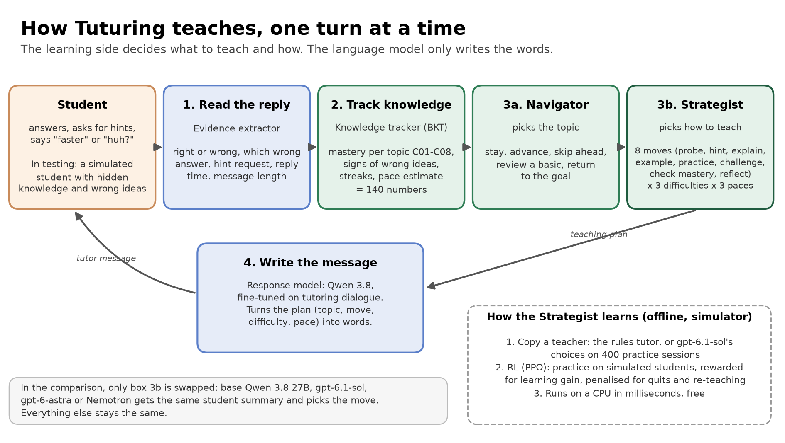
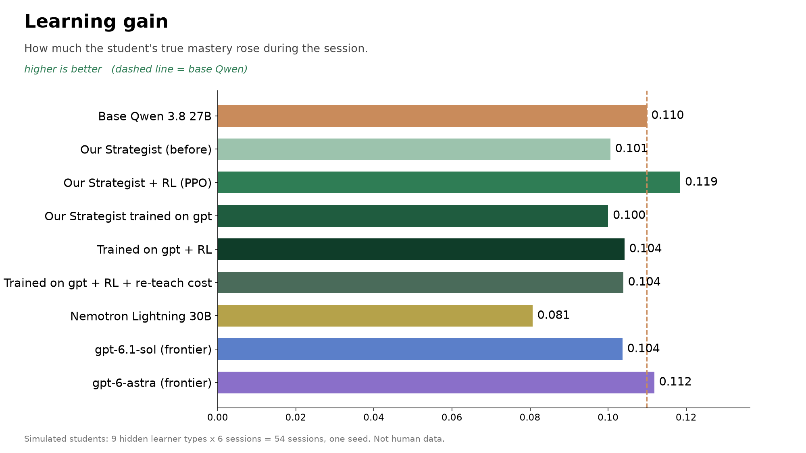
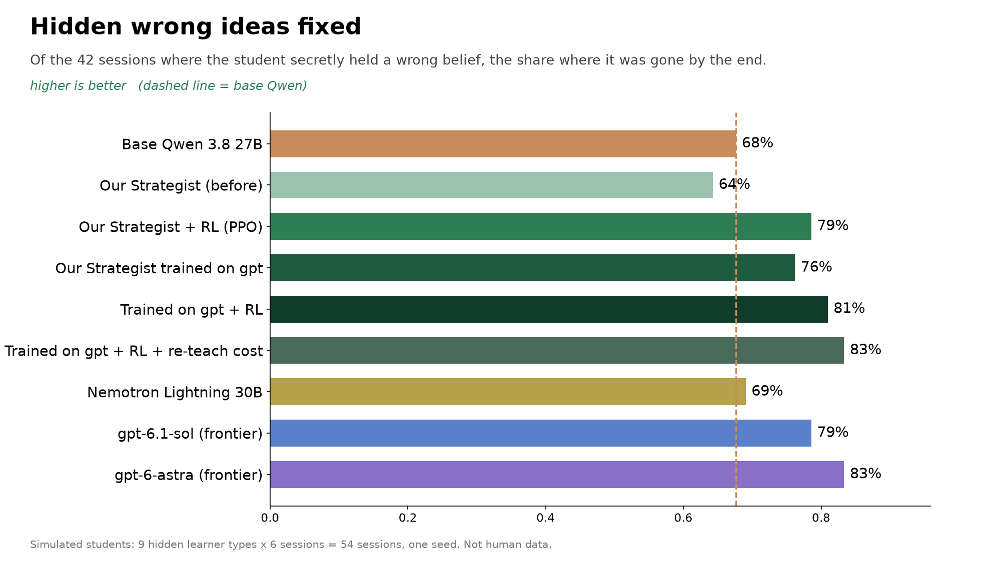
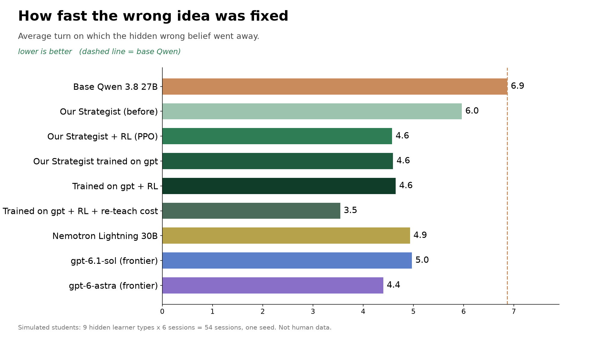
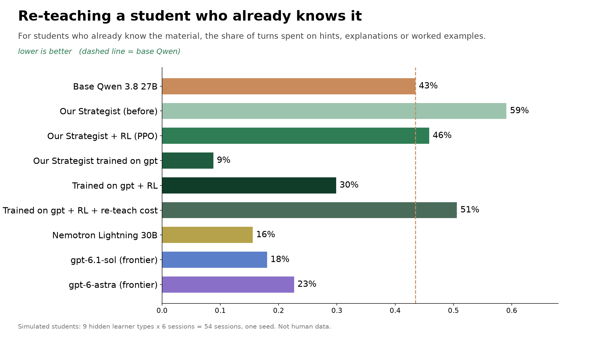
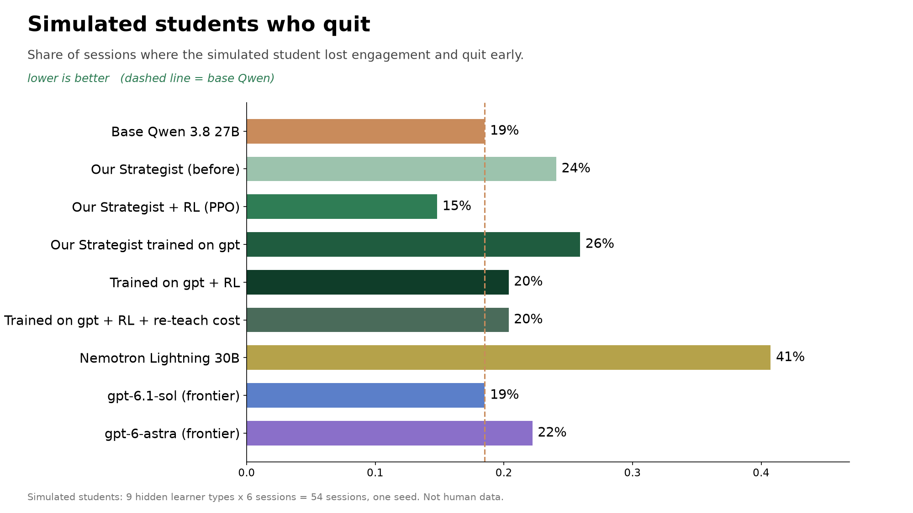
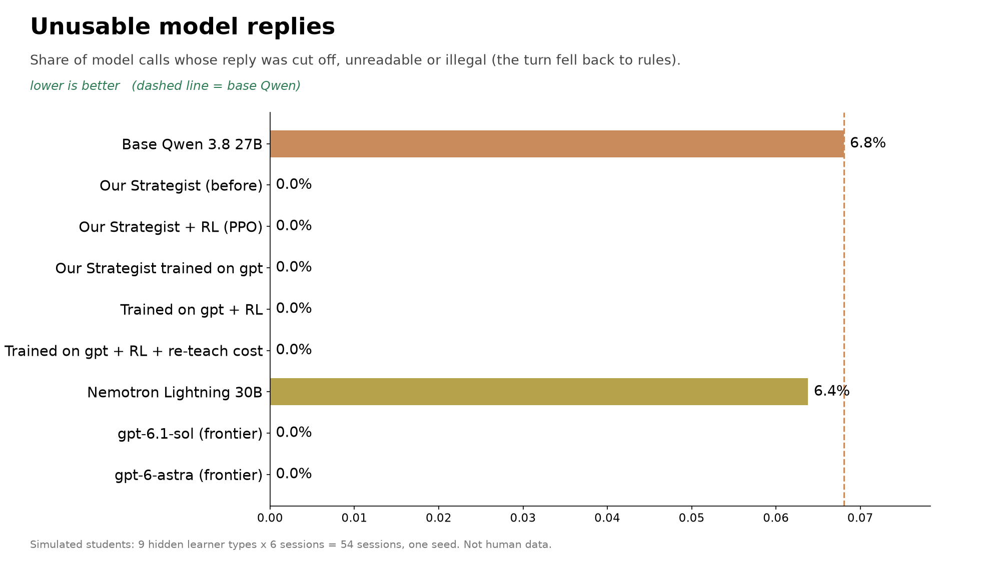
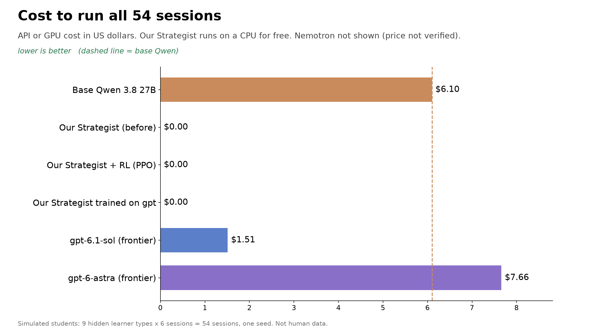
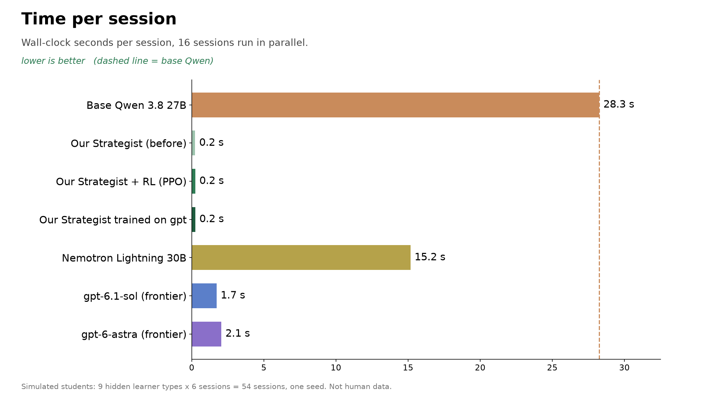

# Adaptive AI Tutor

A probability tutor prototype with a deterministic response stub, a simulated learner, and tools for training and evaluating the Strategist. It targets Python 3.12 and uses `uv`.

## Problem

AI tutors don't work out what a student actually knows. They re-teach material the student already has and miss hidden wrong ideas, such as flipping P(A given B) and P(B given A). Using a frontier model to plan every turn helps, but it's slow and costs money per turn, and base Qwen 3.8 is slower still and sometimes returns unusable replies.

## Solution

Tuturing tracks what each student knows and believes after every reply: mastery of each topic, signs of specific wrong ideas, and preferred pace. A small planner trained with reinforcement learning (PPO) on simulated students then picks the topic, the teaching move, the difficulty and the pace. A fine-tuned Qwen 3.8 writes the message.



## Results

These results come from a hidden-knowledge test with 9 learner types and 6 sessions each, 54 sessions in total. Each learner type secretly lacks basics, already knows the material, or holds one specific wrong idea, and the tutor has to infer which from the student's answers. Only the planner is swapped between arms. All students are simulated: these are one-seed simulator results, not measured human learning.

| Score | Base Qwen 3.8 27B | Our planner + RL | Our planner trained on gpt | gpt-6.1-sol | gpt-6-astra |
|---|---|---|---|---|---|
| Learning gain (higher is better) | 0.110 | **0.119** | 0.100 | 0.104 | 0.112 |
| Hidden wrong ideas fixed | 68% | 79% | 76% | 79% | **83%** |
| Turn the fix happened (lower is better) | 6.9 | 4.6 | 4.6 | 5.0 | **4.4** |
| Re-teaching a student who already knows it (lower is better) | 43% | 46% | **9%** | 18% | 23% |
| Simulated quits (lower is better) | 19% | **15%** | 26% | 19% | 22% |
| Unusable replies | 7% | **0%** | **0%** | 0% | 0% |
| Cost for 54 sessions | $6.10 | **$0** | **$0** (plus $8.90 once to train) | $1.51 | $7.66 |
| Time per session | 28 s | **0.2 s** | **0.2 s** | 1.7 s | 2.1 s |

Compared with base Qwen 3.8, our planner + RL wins on every score except re-teaching, and it matches or beats gpt-6.1-sol on everything except re-teaching. The version trained on gpt-6.1-sol's choices learned from 5,495 of gpt's teaching decisions on 400 practice sessions, at a one-time cost of $8.90. It re-teaches less than any other arm (9%, versus 18% for gpt-6.1-sol), but it gains less and has more quits.

| | |
|---|---|
|  |  |
|  |  |
|  |  |
|  |  |

The test set, evaluator and raw results are on the `devin/1793661049-knowledge-eval` branch, under `data/scenarios/knowledge_v1.yaml`, `tools/learning/knowledge_eval.py` and `evaluation/learning/results/knowledge_v1/`.

## Ownership

| Workstream | Owner | Guide |
|---|---|---|
| Response, SFT, and serving | Person A | [Person A tasks](docs/person_a_tasks.md) |
| Learning, simulator, and policies | Person B | [Person B tasks](docs/person_b_tasks.md) |

See [OWNERS.md](OWNERS.md) for the path-by-path ownership map.

## Quick start

Run these commands from the repository root:

```bash
uv sync --extra learning
uv run python -m tools.learning.validate_contracts
uv run python -m tools.response.validate_contracts
uv run python -m tools.learning.validate_content --config configs/learning/prototype.yaml
TUTOR_LEARNING_SERVICE_TOKEN=dev uv run python -m tools.learning.serve --config configs/learning/rules.yaml --port 8100
uv run python -m tools.learning.simulate --config configs/learning/smoke.yaml --episodes 100
uv run python -m tools.learning.evaluate --config configs/learning/smoke.yaml --split validation --policies rules,random,always_hint --episodes-per-scenario 20
uv run python -m tools.learning.train_bc --config configs/learning/bc.yaml
uv run python -m tools.learning.train_ppo --config configs/learning/ppo_smoke.yaml --seed 0 --init PATH_TO_BC_CHECKPOINT
uv run python -m tools.learning.score_decisions --policy rules
TUTOR_LLM_BASE_URL=https://api.fireworks.ai/inference/v1 TUTOR_LLM_MODEL=accounts/fireworks/models/qwen3p8-27b uv run python -m tools.learning.score_decisions --policy llm
```

Read the [product requirements](docs/adaptive_ai_tutor_prd.md) and [training data options](docs/training_data_options.md) for design context.

## Status

The contracts, starter code, simulator, and training tools are scaffolded. No production models have been trained, and every simulator result is simulated, not a measured learning outcome.

## Workspace records

This repository is also the project record for `tuturing` in Xueming's personal agent workspace, where agent sessions run from the Lark group **Tuturing** on his Mac mini.

- [Current understanding](brief.md), [decisions](decisions.md) and [agent instructions](AGENTS.md); `CLAUDE.md` links to the same file.
- `tasks/` is generated by the workspace from its task records. `journal/` (conversation source records) stays local on the Mac mini and is not committed.
- Local checkout on the Mac mini: `/Users/xuemingxu/workspace/projects/tuturing`.
- Lark project group: **Tuturing** (`oc_454768961d023702c1b8895f7238be31`), topic mode. Start a topic there to work on Tuturing with the workspace agents.
